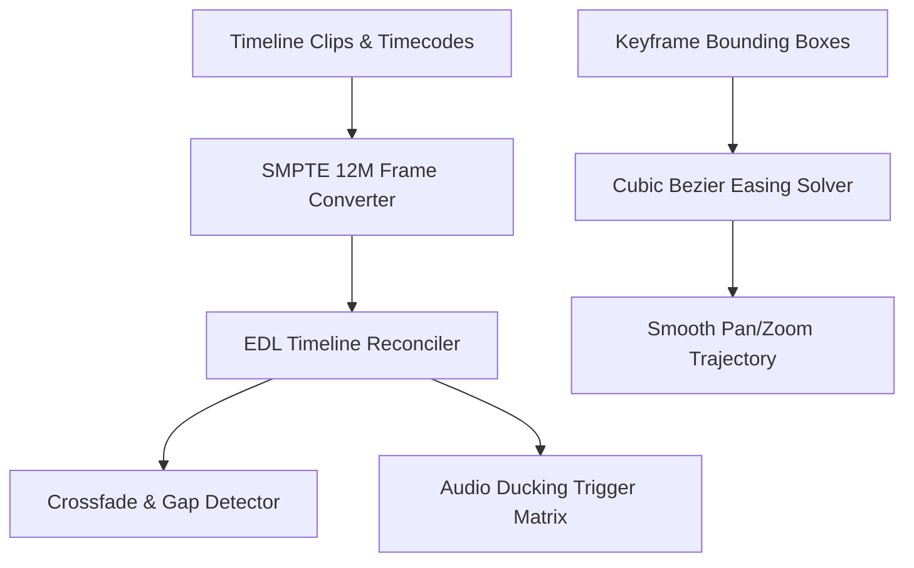

# openclaw-genpark-video-creator


OpenClaw GenPark Video Creator is a zero-dependency video editing and timeline orchestration engine implementing SMPTE 12M drop-frame/non-drop-frame timecode conversion, smooth cubic Bezier Ken Burns camera pan/zoom trajectories, and multi-track EDL timeline reconciliation.



## Features
- **SMPTE 12M Drop-Frame Standard**: Converts between HH:MM:SS;FF and frame numbers with exact NTSC drop-frame compensation.
- **Ken Burns Motion Solver**: Generates smooth cubic Bezier viewport interpolation curves with velocity analytics.
- **EDL Timeline Reconciliation**: Detects clip overlaps, timeline gaps, and triggers automatic audio ducking attenuation.

## Quickstart

```python
from client import OpenClawGenParkVideoCreator

vc = OpenClawGenParkVideoCreator()
tc = vc.convert_smpte_timecode("01:00:00;00", fps=29.97, is_drop_frame=True)
print("Frame Number:", tc["frame_number"])
```

## License
MIT
