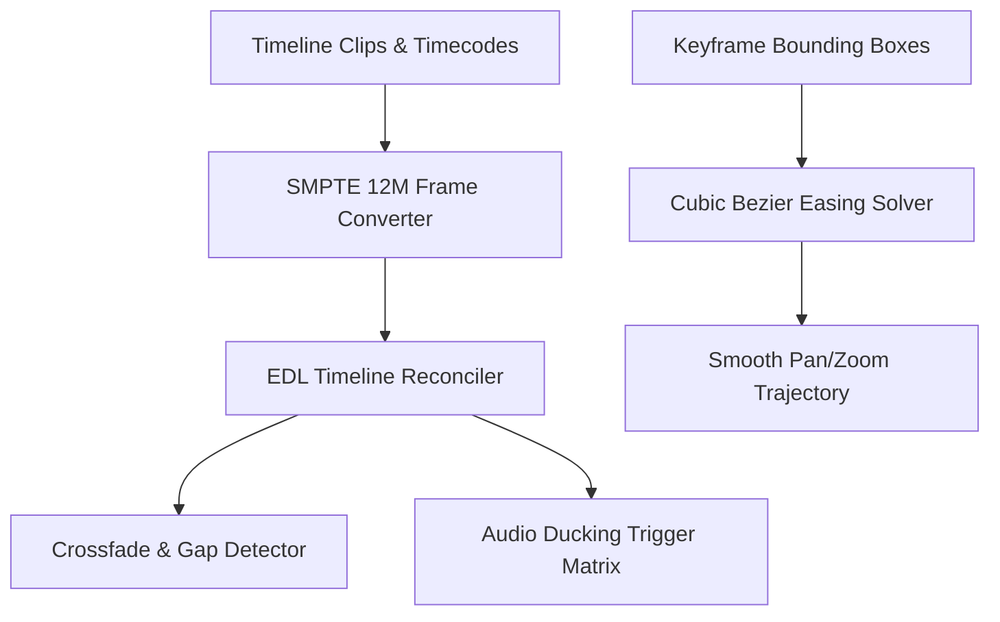

# openclaw-genpark-video-creator


OpenClaw GenPark Video Creator provides a standard-library video editing and timeline orchestration engine implementing SMPTE 12M drop-frame/non-drop-frame timecode conversion, smooth cubic Bezier Ken Burns camera pan/zoom trajectories, and multi-track EDL timeline reconciliation.



## Features
- **SMPTE 12M Drop-Frame Standard**: Converts between HH:MM:SS;FF and frame numbers with exact NTSC drop-frame compensation.
- **Ken Burns Motion Solver**: Generates smooth cubic Bezier viewport interpolation curves with velocity analytics.
- **EDL Timeline Reconciliation**: Detects clip overlaps, timeline gaps, and triggers automatic audio ducking attenuation.

## Quickstart

```python
from client import OpenClawGenParkVideoCreator

vc = OpenClawGenParkVideoCreator()
tc = vc.convert_smpte_timecode("01:00:00;00", fps=29.97, is_drop_frame=True)
print("Frame Number:", tc["frame_number"])
```

## MCP Setup

The core Python client uses only the standard library. Running the MCP server requires **Python 3.10+** and the official **`mcp>=1.0.0,<2` SDK**. From the repository directory:

```bash
python -m venv .venv
.venv/bin/python -m pip install -r requirements.txt
```

On Windows, use `.venv\Scripts\python.exe` instead. Configure the MCP client to use this environment's Python executable. The server runs locally over stdio; the GitHub repository URL is not a remote MCP endpoint.

Start the server from the repository directory:

```bash
.venv/bin/python mcp_server.py
```

## License
MIT
